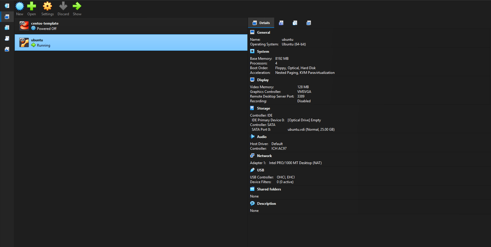

# Setting Up My Ubuntu 26.04 LTS Virtual Machine For Practice

This guide is to enable you create an Ubuntu Desktop virtual machine in Oracle VirtualBox on a Windows computer. It is also the same for mac users **`(Do your own research till I get a mac, LOL)`**. The reason for the VM is simply to allow us to break and fix a machine in a continuous loop without actually endangering our personal files on our PC.

Think of it as a lab where we can do anything without fear of real consequences like data loss, hacking, and the likes.

## 1. Download the required software

1. Install [Oracle VirtualBox](https://www.virtualbox.org/wiki/Downloads).
2. Download the [Ubuntu 26.04.1 LTS Desktop ISO](https://releases.ubuntu.com/26.04/ubuntu-26.04.1-desktop-amd64.iso).


> **Note:** At the time of this practice, Ubuntu 26.04.1 was the latest Long Term Support (LTS) release. Always download an LTS release for long-term security updates.

## 2. Create the virtual machine

1. Open VirtualBox and select **New**.
2. Name the VM `Ubuntu` or whatever you want and select the downloaded ISO file.
3. If VirtualBox offers an unattended installation, choose to skip it so you can follow the Ubuntu installer yourself.
4. Assign memory and processors. My configuration uses **8192 MB RAM** and **4 CPUs**; use less if your computer cannot spare those resources.
5. Create a virtual hard disk of at least **25 GB**. Dynamically allocated storage is alright for this setup if you have the space for it.

## 3. Set the display and network

With the VM powered off, open **Settings**:

1. Under **Display**, set video memory to **128 MB**.
2. Set **Graphics Controller** to **VBoxSVGA** and leave **Enable 3D Acceleration** off. This avoids the `vmwgfx` graphics error shown in the troubleshooting screenshot.
3. Under **Network**, leave **Adapter 1** enabled and attached to **NAT** for internet access.

My VM configuration uses 8 GB RAM, 4 CPUs, a 25 GB virtual disk, 128 MB video memory, and NAT. It uses VMSVGA; use VBoxSVGA instead if you encounter the graphics error below.



## 4. Install Ubuntu

1. Select the VM and click **Start**.
2. In the Ubuntu welcome screen, choose **Install Ubuntu**.
3. Select your language and keyboard layout.
4. Choose the default installation and updates options, then continue.
5. Select **Erase disk and install Ubuntu**. This erases only the VM's virtual disk, not your Windows files.
6. Choose your time zone, create a username and password, and start the installation.
7. When installation finishes, restart the VM. If prompted, remove the installation medium and press Enter.

## 5. Update Ubuntu

Open Terminal in Ubuntu and run:

```bash
sudo apt update && sudo apt upgrade -y
```

## Troubleshooting

While carrying out my installation, I faced the following errors, if you also encounter this, follow the insructions below to fix it.

### `vmwgfx` unsupported hypervisor error


Power off the VM, open **Settings > Display**, change the graphics controller to **VBoxSVGA**, and make sure 3D acceleration is off. Start the VM again.

### RCU stalls during boot


Power off the VM and try increasing the cpu **Settings > System > Processor** to **2 CPUs** or more depending on your system configuration. Also confirm hardware virtualization (Intel VT-x or AMD-V) is enabled in the host computer's firmware and that VirtualBox is up to date.

Remember that your virtual box is sharing the resources of your actual system so do your configuration within your computers' limit.


